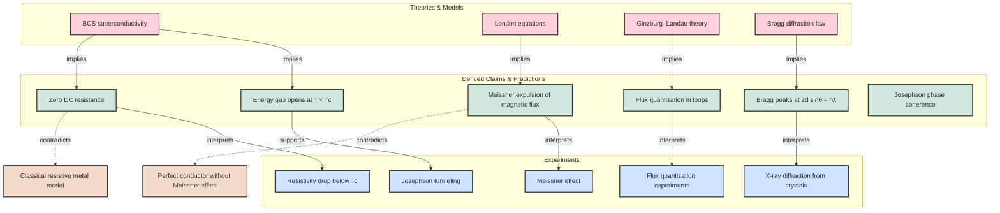

# Bragg and superconductivity

This note connects two important strands of modern condensed matter physics:
- Bragg diffraction as a probe of crystal periodicity
- superconductivity as a phase-coherent quantum state with macroscopic order

## Core idea

Crystalline order produces Bragg peaks, while superconductivity produces a macroscopic quantum state characterized by zero resistance, Meissner expulsion, and flux quantization. The same formal tools of periodicity and phase coherence appear in both domains, but in different physical settings.

## Evidence graph

The diagram above encodes a compact evidence structure:

- `Bragg diffraction law` implies `Bragg peaks at 2d sinθ = nλ`
- `BCS superconductivity` implies `energy gap` and `zero DC resistance`
- `London equations` imply `Meissner expulsion`
- `Ginzburg–Landau theory` implies `flux quantization`
- Each theoretical consequence is connected to an experimental reading

## Interpretation

The central scientific pattern is that a model becomes compelling when it predicts multiple independent observations without contradiction. In superconductivity, the same theory explains resistivity collapse, flux expulsion, and phase coherence. In crystallography, Bragg's law explains diffraction peaks from the lattice geometry.

## Key lesson

Strong evidence in physics comes from cross-connection: a model that explains a structural experiment and a quantum-condensed-state experiment is much more persuasive than a mechanism fitted to only one phenomenon.
```

