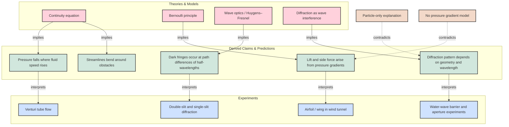

# Diffraction and Bernoulli

This note combines two classic explanatory systems:
- Bernoulli’s principle for fluid flow and pressure gradients
- diffraction as a wave phenomenon that depends on path differences and geometry

## Core idea

The Bernoulli principle says that in steady incompressible flow, pressure decreases where speed increases. Diffraction, by contrast, follows from the wave nature of light or water, where phase differences create constructive and destructive interference.

## Evidence graph

The diagram above organizes the structure of the argument:

- `Continuity equation` and `Bernoulli principle` imply a pressure drop where the flow speeds up
- `Wave optics` and `diffraction` imply alternating bright and dark regions from phase differences
- These claims are then matched to experiments: venturi flow, airfoil lift, and slit/barrier diffraction

## Why the two topics matter together

Although Bernoulli and diffraction are not the same theory, they are both examples of how physics turns observations into structural claims. In each case, the model does not just describe the experiment; it predicts new effects and constrains what is and is not possible.

## Scientific lesson

When a model is successful, it is not enough that it fits one observation. It must also explain several independent experiments and remain stable under contrast with rival explanations.
```
